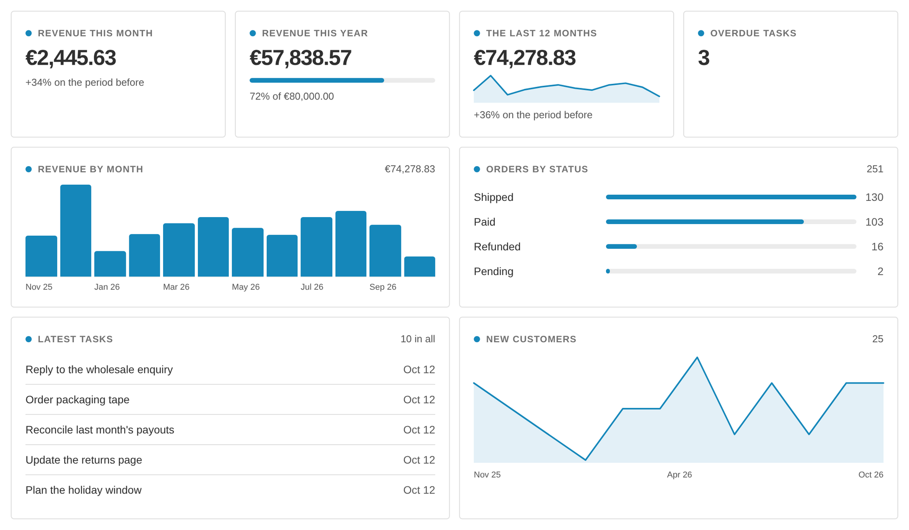

# payload-plugin-widgets

[](https://www.npmjs.com/package/payload-plugin-widgets)
[](https://www.npmjs.com/package/payload-plugin-widgets)
[](https://github.com/m-grgic/payload-plugin-widgets/actions/workflows/ci.yml)
[](https://github.com/m-grgic/payload-plugin-widgets/blob/main/LICENSE)

A [Payload CMS](https://payloadcms.com) plugin for dashboard widgets that read from your collections: **KPI figures,
lists and charts**. Add the plugin and every collection can be put on the admin dashboard. Whoever is signed in can
set a widget up in a drawer, a project can put some there ready-made, and the same three can stand on any other page
of the admin.



## Install

```sh
pnpm add payload-plugin-widgets   # or npm install, or yarn add
```

```ts
// payload.config.ts
import { buildConfig } from 'payload'
import { widgetsPlugin } from 'payload-plugin-widgets'

export default buildConfig({
  // …
  plugins: [widgetsPlugin()],
})
```

Then write the import map again, as after adding any plugin that brings components:

```sh
pnpm payload generate:importmap
```

That is all. There is no stylesheet to add and no route to mount. Put the plugin **after the plugins that add
collections**.

## Quick start

With nothing but `widgetsPlugin()`, open the dashboard and choose **Edit Dashboard** from the menu beside its name.
Then add a "Figure", a "List" or a "Chart". The pencil on a widget opens its drawer.

To have a dashboard that starts with something on it, here for collections `tasks` (with `status` and `dueDate`)
and `orders` (with `total`), as in the demo:

```ts
import { chart, figure, list, widgetsPlugin } from 'payload-plugin-widgets'

widgetsPlugin({
  currency: 'EUR',
  timeZone: 'Europe/Zagreb',
  widgets: [
    figure('open-tasks', 'tasks', { label: 'Open tasks', where: { status: { not_equals: 'done' } } }),
    figure('overdue', 'tasks', { label: 'Overdue', where: { dueDate: { less_than: 'today' }, status: { not_equals: 'done' } } }),
    figure('sold', 'orders', { label: 'Sold this month', measure: 'total', period: 'month', compare: 'previous' }),
    chart('orders-by-month', 'orders', { label: 'Orders', measure: 'total', by: 'time', period: 'last12', as: 'columns' }),
    list('latest-orders', 'orders', { label: 'Latest orders', limit: 5 }),
  ],
})
```

The editor offers and checks the collection slugs and the field names in `where`, `measure`, `by` and `date`, from
your `payload-types.ts`. The config checks them again as it is built.

## What it does

- **Nothing to declare.** Every collection is a source as its fields describe it: how many there are, a sum for
  each number, a group for each select, checkbox and relationship, and a list of the latest.
  [Sources and measures](https://github.com/m-grgic/payload-plugin-widgets/blob/main/docs/sources-and-measures.md)
- **Set up by whoever is looking.** A "Figure", a "List" and a "Chart" are added in the dashboard's edit mode and
  filtered with the admin's own filter builder.
  [User widgets and access](https://github.com/m-grgic/payload-plugin-widgets/blob/main/docs/user-widgets-and-access.md)
- **Or by the config.** `figure(…)`, `list(…)` and `chart(…)` put widgets there ready-made. They are typed against
  your generated types, and checked as the config is built with a "did you mean" where a name is off.
  [Configuration](https://github.com/m-grgic/payload-plugin-widgets/blob/main/docs/configuration.md),
  [where and dates](https://github.com/m-grgic/payload-plugin-widgets/blob/main/docs/where-and-dates.md),
  [errors](https://github.com/m-grgic/payload-plugin-widgets/blob/main/docs/errors.md)
- **Charts without a chart library.** Bars, columns and lines, with several series, tooltips, a scale and a table
  for screen readers.
  [Charts](https://github.com/m-grgic/payload-plugin-widgets/blob/main/docs/charts.md)
- **With whoever's access.** Every read is made as the signed-in user, so access control always applies. `access`
  functions, written as Payload's own are, say who else a widget is not for.
  [Who sees what](https://github.com/m-grgic/payload-plugin-widgets/blob/main/docs/user-widgets-and-access.md#who-sees-what)
- **Added up by the database.** On Postgres, sums and charts are one query. Elsewhere they are read record by
  record, within limits you can set.
  [Limits and performance](https://github.com/m-grgic/payload-plugin-widgets/blob/main/docs/limits-and-performance.md)
- **No script draws anything.** The tiles are server components and plain CSS that follow the admin's theme, light
  and dark. [Theming](https://github.com/m-grgic/payload-plugin-widgets/blob/main/docs/theming.md)
- **Yours to take apart.** You can have the widgets on any page, the data without the tiles, views of your own,
  and widgets that are all your own.
  [On any other page](https://github.com/m-grgic/payload-plugin-widgets/blob/main/docs/headless.md),
  [drawing it your own way](https://github.com/m-grgic/payload-plugin-widgets/blob/main/docs/advanced.md)

## Requirements

| | |
| --- | --- |
| Payload | 3.90 or later (the modular dashboard), or the 4.0 beta |
| Next.js | what your Payload supports; developed on 16.4 |
| React | 19 |
| Node | 20.9 or later |
| Database | any Payload adapter |

Payload 4 is in beta, and so is the support for it here: the same code is type-checked and tested on
4.0.0-beta.11, which wants Node 24 and Next.js 16.4.5 or later, and the tiles fall back to its colours. A later
beta may change what this relies on.

Developed with Payload 3.90.2, Next.js 16 and React 19.3 on Postgres. The tests run on Payload 3.90.0 and the
latest 3.x, on Next.js 15.4 and 16, and on Node 22 and 24.

## More

- [CHANGELOG](https://github.com/m-grgic/payload-plugin-widgets/blob/main/CHANGELOG.md): what changed in each
  version.
- [UPGRADING](https://github.com/m-grgic/payload-plugin-widgets/blob/main/UPGRADING.md): what to change when moving
  to a new minor version, such as 0.5 to 0.6.
- [SECURITY](https://github.com/m-grgic/payload-plugin-widgets/blob/main/SECURITY.md): how to report a security
  problem.
- [CONTRIBUTING](https://github.com/m-grgic/payload-plugin-widgets/blob/main/CONTRIBUTING.md), and
  [working on the plugin](https://github.com/m-grgic/payload-plugin-widgets/blob/main/docs/development.md): the
  demo in `dev/`, a small shop with made-up data that every screenshot is taken of.

## Licence

[MIT](./LICENSE) © Matija Grgić
