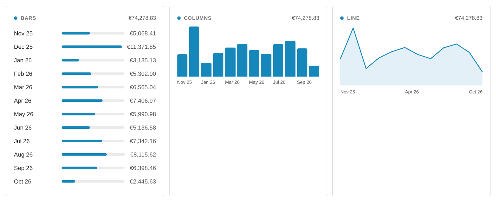
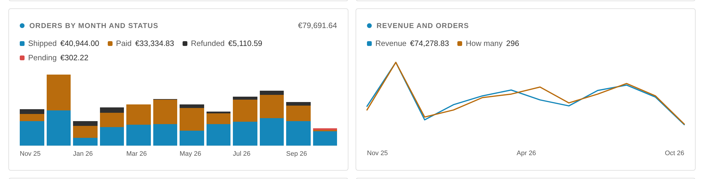

# Charts



```ts
chart('revenue-by-month', 'orders', { label: 'Revenue by month', measure: 'total', by: 'time', period: 'last12', as: 'columns' })
chart('orders-by-status', 'orders', { label: 'Orders by status', by: 'status', period: 'year' })
```

| Option | | |
| --- | --- | --- |
| `measure` | as of a [figure](./configuration.md#figures), or several | What is drawn. How many there are where it is left out. Several are a series each: `['revenue', 'count']`. |
| `by` | `'time'` or a group | Over time, or split by a select, a checkbox or a relationship of the collection. A select gives the labels of its options, a relationship the titles of what it points at. |
| `series` | a group | A series for each of what is in another field: every bar told apart by it. The five there is most of, and the rest as one. |
| `as` | `'bars' \| 'columns' \| 'line'` or a view of your own | Bars one to a row where it is left out. |

It also takes what [every ready-made widget takes](./configuration.md#what-all-of-them-take): `filter`, `where`,
`period`, `date`, `from`, `to`, `access`, `overrideAccess`, `home`, `action` and `after`.

Over time, a chart is drawn by day up to two months and by month beyond. Split by a field, it draws the eight
there is most of, and the rest as "Other". Each bar leads to the records it is made of.

The titles of what a relationship points at are read as the person looking, even under `overrideAccess`. What
they may not open is named by its id.

## Several series

A chart tells apart either what is in a second field or several measures. Each is drawn in a colour of its own
and named above it with what it comes to:



```ts
chart('revenue-by-status', 'orders', { label: 'Orders by month and status', measure: 'total', by: 'time', series: 'status', period: 'last12', as: 'columns' })
chart('revenue-and-orders', orders, { label: 'Revenue and orders', filter: 'sold', measure: ['revenue', 'count'], by: 'time', period: 'last12', as: 'line' })
```

A chart takes `series` or several measures, not both, and it cannot be split by the same field twice
(`by: 'status', series: 'status'`). Each of these stops the config from being built.

What adds up is stacked: the series of a field, where the measure is a sum or a count. Anything else stands side
by side: an average of each, or measures of different kinds.

Series side by side that are read alike share one scale. Those that are not each get their own, so that euros and
a count can share a chart. The legend then says "Each series is drawn to its own scale", and the scale names no
amount. Other measures than the first are drawn for the first one's eight bars.

## Reading a chart

No script draws anything.

- A column or a point says what it comes to on the pointer and on focus, in a tooltip.
- A scale beside the columns or the line says what the top comes to, and where nought is when anything goes below
  it.
- Every column and point that leads somewhere is a link, named with its label and amount.
- A screen reader is given a table of the figures.

## Colours

The series are `--widgets-series-1` to `--widgets-series-8`, in order. A ninth series is drawn as the first again.
Where they are not set, the plugin has eight colours of its own, one set for the light theme and one for the dark,
told apart with the common kinds of colour blindness. See [theming](./theming.md#series-colours).

## Money

A chart of money is drawn in one currency, the one the plugin was given. Records in another are left out, and the
tile says how many. A figure of money says each currency's total.
