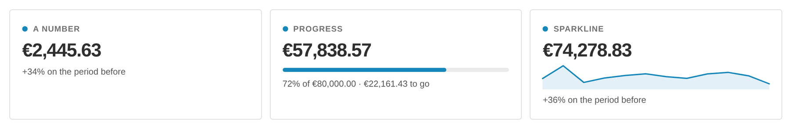

# Configuration

- [Installing](#installing)
- [The options](#the-options)
- [Ready-made widgets](#ready-made-widgets): [figures](#figures), [lists](#lists), [what all of them take](#what-all-of-them-take)
- [Languages, time and numbers](#languages-time-and-numbers)
- [Entries](#entries)

## Installing

```sh
pnpm add payload-plugin-widgets
```

```ts
// payload.config.ts
import { buildConfig } from 'payload'
import { widgetsPlugin } from 'payload-plugin-widgets'

export default buildConfig({
  // …
  plugins: [widgetsPlugin()],
})
```

Then write the import map again, as after adding any plugin that brings components:

```sh
pnpm payload generate:importmap
```

That is all. There is no stylesheet to add and no route to mount: the components bring their styles, and
everything is read on the server.

Put the plugin **after the plugins that add collections**. It runs with `order: 100`, so plugins that leave their
order open come first anyway; a collection that is added later still is named in a warning when Payload starts.

## The options

```ts
widgetsPlugin({
  sources,       // { [name]: source(…) | boolean }; false only for a collection there is
  discover,      // false: only the declared sources
  strict,        // true; false has a field that is not there only logged as Payload starts
  widgets,       // figure(…), list(…), chart(…), widget(…)
  views,         // { [name]: { kind: 'figure' | 'list' | 'chart', label, Component } }
  userWidgets,   // { kinds, sources, access } or false: what the drawer offers, and to whom
  i18n,          // { translations, plurals, translate, plural, locale }
  timeZone,      // 'UTC'
  weekStartsOn,  // 1
  currency,      // 'EUR'
  format,        // (value, { style, locale, currency }) => string | undefined
  sums,          // 'database'; 'records' to read record by record always
  cache,         // seconds what was read is kept for; nothing is kept without it
  limits,        // { records: 5000, groups: 1000, timeoutMs }
})
```

| Option | | See |
| --- | --- | --- |
| `sources` | The sources, by name: `false` leaves a collection out, `source(…)` declares one. | [Sources](./sources-and-measures.md) |
| `discover` | `false` to have only the sources that are declared. | [Sources](./sources-and-measures.md#what-is-found-by-itself) |
| `strict` | Whether a widget or a source set up with a field that is not there stops the config. `true` where it is left out. | [Errors](./errors.md#strict) |
| `widgets` | The dashboard everybody starts with. | [Below](#ready-made-widgets), [charts](./charts.md) |
| `views` | Ways of your own to draw a widget. | [Advanced](./advanced.md#a-view) |
| `userWidgets` | Which widgets anybody may set up in the drawer. | [User widgets and access](./user-widgets-and-access.md#which-widgets-the-drawer-offers) |
| `i18n`, `timeZone`, `weekStartsOn`, `currency`, `format` | How things are said. | [Below](#languages-time-and-numbers) |
| `sums`, `cache`, `limits` | What is asked of the database. | [Limits and performance](./limits-and-performance.md) |

An `admin.dashboard.defaultLayout` of the project's own is left as it is; the ready-made widgets are then there to
be added. A widget of `admin.dashboard.widgets` keeps its slug: a ready-made one may not take it.

## Ready-made widgets

`widgets` in the options is the dashboard everybody starts with, in the order given: figures first in a row of
small tiles, then lists and charts side by side, then Payload's own list of collections.

Each is made by a function that takes a **slug** of its own (what Payload keeps it by, and `data-widget` in a
stylesheet), a **source** (a collection's slug, or a [declared source](./sources-and-measures.md#declaring-a-source)),
and what it shows. Two widgets may not have one slug, and none may be called `figure`, `records` or `chart` (the
drawer's own) or `collections` (Payload's).

```ts
import { chart, figure, list, widgetsPlugin } from 'payload-plugin-widgets'

widgetsPlugin({
  widgets: [
    figure('open-tasks', 'tasks', { label: 'Open tasks', where: { status: { not_equals: 'done' } } }),
    chart('orders-by-month', 'orders', { label: 'Orders', measure: 'total', by: 'time', period: 'last12', as: 'columns' }),
    list('latest-orders', 'orders', { label: 'Latest orders', limit: 5 }),
  ],
})
```

The collection slugs, the field names in `where`, `measure`, `by` and `date` are all offered and checked by the
editor from your `payload-types.ts`. What is still wrong as the config is built stops it, and says what was
probably meant: see [errors](./errors.md).

Charts have [a page of their own](./charts.md).

### Figures



```ts
figure('sold', 'orders', {
  label: 'Sold this month',
  measure: 'total',        // a number field (its sum), or { sum | avg | min | max: 'field' }; left out: how many
  period: 'month',
  compare: 'previous',     // also read for the period before
  goal: 5000,              // what it is set against
  as: 'progress',          // or 'sparkline'; left out: the number alone
  note: '{change} on last month · {left} to go',
})
```

| Option | | |
| --- | --- | --- |
| `measure` | `string \| { sum \| avg \| min \| max: field or formula, format?, currency? }` | How many there are where it is left out. A number field by name is added up. Of a declared source, one of its measures by name. One said in place is of a number field of the collection, or a [formula](./sources-and-measures.md#formulas). |
| `compare` | `'previous'` | Also read for the period before. Needs a period that has a beginning: not `all`, `past` or `upcoming`, and `custom` only with a `from`. |
| `goal` | `number` | What the figure is set against, in what the measure counts. |
| `as` | `'number' \| 'progress' \| 'sparkline'` or a view of your own | `progress` draws how far towards the goal it is, and does not compile without a `goal`; `sparkline` what it was over the period. |
| `note` | `string` | The line under the number, in place of the usual one. |
| `fields`, `data` | `Field[]`, `object` | Settings of the widget's own in its drawer, and what they start as. A measure reads them from `context.data`. |
| `trusted` | `string[]` | With `overrideAccess`: which of `fields` whoever has it may set. See [access](./user-widgets-and-access.md#settings-of-a-widget-read-with-the-servers-access). |

Without a `note` a figure says the usual of what it was given: "+12% on the period before · 60% of €5,000.00". A
note can use:

| | |
| --- | --- |
| `{value}` | the figure as it is shown |
| `{note}` | what the line would have said |
| `{previous}`, `{change}` | with `compare`: what it was then, and by how much it changed ("+12%") |
| `{goal}`, `{percent}`, `{left}` | with a goal: the goal, how much of it this is, and how much is missing |

A month or a year to date is compared with the same days of the one before; any other period with the one that is
as long and ends where it starts. On 31 March, "this month" is set against the whole of February.

### Lists

```ts
list('latest-orders', 'orders', { label: 'Latest orders', limit: 5 })
list('my-tasks', tasks, { label: 'My tasks', list: 'upcoming', filter: 'open' })
```

| Option | | |
| --- | --- | --- |
| `list` | `string` | One of the source's lists. Where it is left out, the first one a declared source declares; of a collection by its slug there is one, `latest`. |
| `limit` | `number` | How many rows. |
| `filter`, `where` | | As below. A list has no period. |
| `as` | a view of your own | A list is drawn as rows unless a [view](./advanced.md#a-view) draws it otherwise. |

Every row leads to its document; the head of the tile to the whole list. A [declared list](./sources-and-measures.md#a-list)
can say which rows are late, offer a link to a new document and a box that adds one by its title.

### What all of them take

| Option | | |
| --- | --- | --- |
| `label` | `string \| { [language]: string }` | Required. In English, said in the admin's other languages through [`i18n`](#languages-time-and-numbers), or given in several at once: `{ en: 'Orders', de: 'Bestellungen' }`. |
| `filter` | `string` | One of a declared source's filters. |
| `where` | a filter | Which records, as Payload filters them anywhere, typed against the collection. On top of `filter`. See [where and dates](./where-and-dates.md). |
| `period` | see [periods](./where-and-dates.md#periods) | Which records by date. Figures and charts. |
| `date` | field path | The date the period goes by, by its path as a source's `date` is (`sessions.createdAt`); the source's own where it is left out. |
| `from`, `to` | `'YYYY-MM-DD'` | The first and the last day of `period: 'custom'`. Either may be left out. |
| `access` | `Access` | [Who the widget is for](./user-widgets-and-access.md#who-sees-what), as Payload asks it of a collection: `({ req }) => boolean \| Where`. Whoever its source is for where it is left out. |
| `overrideAccess` | `boolean` | Figures and charts: [read with the server's access](./user-widgets-and-access.md#a-total-of-what-somebody-may-not-open) in place of the person's own. Needs an `access`. |
| `home` | `boolean \| Access` | Who *starts with it* on their dashboard, where that is fewer than it is for. `false` is nobody: it is then only there to be added. |
| `action` | `{ label, href }` | A link of your own in the head of the tile. `label` may be in several languages as well. |
| `after` | component path | Something of your own drawn under what the widget shows (`'src/components/Hint.tsx#Hint'`). It is handed `req`, `widgetSlug` and `widgetData`. |

A widget that is all your own, `widget(…)`, is on the [advanced](./advanced.md#a-widget-that-is-all-your-own) page.

## Languages, time and numbers

```ts
widgetsPlugin({
  timeZone: 'Europe/Zagreb',   // where a day starts and ends; UTC where it is left out
  weekStartsOn: 1,             // Monday, the default; 0 is Sunday
  currency: 'EUR',             // of amounts that do not say theirs, and the one charts are drawn in
  format: (value, { style, currency }) => (style === 'money' ? `${value.toFixed(2)} ${currency}` : undefined),
  i18n: {
    translations: { de: { 'Today': 'Heute', 'by {what}': 'nach {what}', 'Open tasks': 'Offene Aufgaben' } },
    plurals: { de: { record: { one: 'Eintrag', other: 'Einträge' } } },
    locale: language => (language === 'de' ? 'de-AT' : language),
  },
})
```

Everything is written in English and said in the language of the request. Numbers, amounts, hours and dates are
written by `Intl` in that language; `format` is only for where that is not how you write them, and whatever it
returns nothing for is written as usual.

- `STRINGS` is the full list of what the widgets say, to translate; `PLURALS` what they count. A key of
  `translations` that is nearly one of them, but not quite, is warned of as Payload starts, with what was meant:
  `de "A figure": did you mean "Figure"?`.
- What you write yourself (the label of a source, of a widget, of a filter, of an action) is said through the same
  dictionary. A label can also be given in several languages at once, as Payload's own are:
  `{ en: 'Orders', de: 'Bestellungen' }`.
- `plurals` are by language under what the thing is called for one in English, in the forms `Intl.PluralRules`
  names: `{ hr: { record: { one: 'zapis', few: 'zapisa', other: 'zapisa' } } }`.
- A project with a dictionary of its own gives `i18n.translate(language, text, vars)` and
  `i18n.plural(language, count, one, many)` instead.
- A day starts where `timeZone` says, a week on the day `weekStartsOn` says. A figure that is one day off around
  midnight wants a `timeZone`.

## Entries

| | |
| --- | --- |
| `payload-plugin-widgets` | For the Payload config, and anything else on the server: `widgetsPlugin`, `figure`, `list`, `chart`, `widget`, `source`, `count`, `sum`, `reckoned`, `rows`, `records`, `anyOf`, `selected`, `raw`, `readFigure`, `readList`, `readChart`, `Unavailable`, `Misconfigured`, `STRINGS`, `PLURALS`, `PERIODS`, `VIEWS`, and the types. It imports no component. |
| `payload-plugin-widgets/rsc` | Server components: `Figure`, `Records`, `Chart`, `gated`, `contextFor`, the tiles, and `FigureViewProps`, `ListViewProps`, `ChartViewProps`. See [headless](./headless.md) and [advanced](./advanced.md). |
| `payload-plugin-widgets/client` | The client components the drawer and the tiles use. The import map points at them; there is seldom a reason to import one. |
| `payload-plugin-widgets/advanced` | Helpers that are less settled than the rest, and may change in a minor version. See [advanced](./advanced.md#the-advanced-entry). |
| `payload-plugin-widgets/widgets.css` | The stylesheet. |

The types the root entry exports: `Options`, `Sources`, `FigureOptions`, `ListOptions`, `ChartOptions`,
`WidgetDefinition` (what `figure`, `list`, `chart` and `widget` return), `Action`, `Home`, `CollectionHint`,
`FieldHint`, `Moment`, `Dictionary`, `Plurals`, `WidgetString`, `Problem`, `ProblemCode`, `Bar`, `ChartReading`,
`Series`, `FigureReading`, `ListReading`, `ReadFigureOptions`, `ReadListOptions`, `ReadChartOptions`, `Source`,
`AnySource`, `Measure`, `MeasureSpec`, `Reckoned`, `Formula`, `Test`, `Compared`, `Condition`, `Narrowing`,
`WhereOf`, `FieldWhere`, `RawWhere`, `Filter`, `List`, `Row`, `More`, `Reading`, `Context`, `Selection`, `Period`,
`Format`, `Label`, `Access`, `Viewer`, `View`, and the helpers `Doc`, `Fields`, `Numbers`, `Paths`, `From`, `Kind`,
`Calc`, `Amount`, `Point`, `Selected`, `Sort`, `Tone`, `Vars`.
