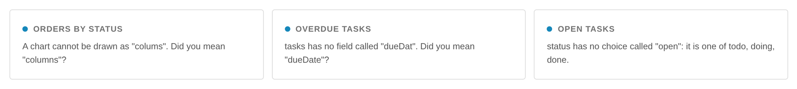

# Errors

- [When something is not there](#when-something-is-not-there)
- [Strict](#strict)
- [On a tile](#on-a-tile)
- [In code of your own](#in-code-of-your-own)
- [Problem codes](#problem-codes)
- [As Payload starts](#as-payload-starts)
- [Troubleshooting](#troubleshooting)

## When something is not there



Some things a ready-made widget or a declared source names may not be there:

- a source, a filter, a measure, a list, a group, a scope or a view;
- a slug used twice, or one the dashboard already has (`collections` is Payload's own).

Any of these **stops the config from being built**. The error says where each problem is in the options, and what
was probably meant:

```
widgetsPlugin: a widget is set up with what is not there
  - "by-status": orders has no group called "stauts". Did you mean "status"?
  - "overdue" at where.dueDate.less_than: dueDate is a date: "tomorow" is neither a date (YYYY-MM-DD) nor a moment such as "today" or "startOfMonth-1m".
```

A slug that is taken is said as `widgetsPlugin: a widget is called by a slug that is taken`, and the two in one line
where both are wrong.

Most of this never gets that far: with `payload-types.ts` generated, a misspelt name does not compile.

## Strict

Fields are checked in two places:

- **As the config is built.** These are the fields in a `where`, a `date`, a measure or a formula, against the
  collections in the config.
- **Once Payload has settled the collections**, in `onInit`. This catches what plugins and Payload added after.

A problem found in either place stops Payload. This is `strict`, and it is on by default.

```ts
widgetsPlugin({ strict: false })
```

With `strict: false`, a problem with a field is logged as an error when Payload starts, and the tile says the same
in place of its figure. Nothing else on the page breaks. This is meant for a field that comes and goes, such as one
another plugin adds only in some environments.

`strict: false` does not cover a source, a filter, a measure, a list, a group, a scope, a view or a slug that is
not there. Those always stop the config.

## On a tile

A widget that cannot be read says so in place of its figure, and every time it is logged:

```
widgets: "Sold this month" could not be read: orders has no field called "totl". Did you mean "total"?
```

| The tile says | When |
| --- | --- |
| "Not available to this account" | The source or the widget is not for the person, or the collection refuses the read. |
| "This took longer to read than the … s it is given" | A read went over `limits.timeoutMs`. Said to anybody, in production as well; logged as a warning, not as an error. |
| "This widget could not be read" | In production, on a ready-made widget or a component. The log has what is wrong. |
| what is wrong, in words | In development; and always on a widget somebody set up in the drawer, in the names the admin shows them. |
| "This could not be read" | Anything other than a problem, in development, with the error's message. |
| "Choose what it shows: the pencil on the widget while editing the dashboard" | A widget from the drawer that has not been given a source yet. |

A component (`<Figure>`, `<Records>`, `<Chart>`) set up by whoever looks at it can be given `owned`. It then says
what is wrong in production too, the way a drawer widget does. With `quiet`, it says nothing at all.

## In code of your own

`readFigure`, `readList` and `readChart` throw:

- `Unavailable` where the source or the widget is not for the person, or nobody is signed in;
- `Misconfigured` where what is picked is not there, with what is wrong as `problems`;
- `TimedOut` where the read took longer than `limits.timeoutMs`.

The config throws `Misconfigured` as well, with `path` on each problem saying where in the options it is.

```ts
import { Misconfigured, readFigure, TimedOut, Unavailable } from 'payload-plugin-widgets'
import { inWords, problemsOf } from 'payload-plugin-widgets/advanced'

try {
  return await readFigure(req, 'orders', { measure: 'total', period: 'month' })
} catch (error) {
  if (error instanceof Unavailable) return null
  if (error instanceof TimedOut) return 'later'
  if (error instanceof Misconfigured) return error.problems.map(problem => problem.code)
  const problems = problemsOf(error)        // Problem[] for a Misconfigured or a TimedOut, even of another copy; undefined otherwise
  if (problems) return problems.map(problem => inWords(problem))
  throw error
}
```

Note that `Misconfigured` does not extend `Unavailable`. A read that took longer than `limits.timeoutMs` throws a
`TimedOut`, exported from the root like the other two and an instance of neither. Its name is `TimedOut`, and
`problemsOf` gives its one problem, with the code `timed-out`.

A `Problem` is:

| | |
| --- | --- |
| `code` | what is wrong, by a name that stays as the words change: [below](#problem-codes) |
| `text`, `vars` | the words, in English with `{name}` to be filled from `vars`; the key to translate it by |
| `hint` | the name that was probably meant |
| `path` | where in what was set up it is: `where.and.0.dueDate.less_than`, `groups.custmer`, `add.1.divide` |

From `payload-plugin-widgets/advanced`, `inWords(problem, t?)` says a problem as one sentence, in another language
with `t`, and `problemsOf(error)` tells a `Misconfigured` or a `TimedOut` apart by its name, so it works where the
error comes from another copy of the plugin.

## Problem codes

| Code | What it says |
| --- | --- |
| `no-source` | There is no source called "{name}" |
| `no-filter` | {source} has no filter called "{name}" |
| `no-measure` | {source} has no measure called "{name}" |
| `no-drawable-measure` | {source} has no measure called "{name}" that can be drawn |
| `no-number` | {source} has no number called "{name}" |
| `no-list` | {source} has no list called "{name}"; {source} has no list to show |
| `no-group` | {source} cannot be split by "{name}" |
| `no-scope` | {source} cannot be narrowed to a "{name}" |
| `no-field` | {source} has no field called "{name}" |
| `no-operator` | "{name}" is not a way to compare {field} |
| `no-choice` | {field} has no choice called "{name}": it is one of {choices} |
| `no-view` | A {kind} cannot be drawn as "{name}" |
| `not-a-date` | "{name}" of {source} is not a date |
| `not-a-number` | "{name}" of {source} is not a number |
| `not-a-moment` | {field} is a date: "{name}" is neither a date (YYYY-MM-DD) nor a moment such as "today" or "startOfMonth-1m" |
| `date-in-rows` | "{name}" of {source} is in the rows of an array: a period goes by a date of the record itself |
| `bad-measure` | A measure said in place is the sum, avg, min or max of a number |
| `bad-formula` | A formula is a number, a number field, or one of add, subtract, multiply, divide, first and when; and what is wrong at a place in one |
| `formula-rows` | A formula reads the rows of one array, not of "{name}" and of "{other}" |
| `list-elevated` | A list is read as whoever looks at it: only a figure or a chart takes overrideAccess |
| `elevated-without-access` | What is read with overrideAccess has to say who it is for: give it or its source an access |
| `series-and-measures` | A chart tells apart its measures or what is in a field, not both |
| `series-twice` | A chart cannot be split by "{name}" twice |
| `no-goal` | Progress is towards a goal: give it one |
| `nothing-before` | There is nothing before this to compare it with: give it a period that has a beginning |
| `no-comparable-figure` | "{name}" of {source} gives no number to compare or to set against a goal |
| `duplicate-slug` | There are two widgets called "{name}" |
| `reserved-slug` | A widget cannot be called "{name}": {owner} has one called that |
| `timed-out` | This took longer to read than the {seconds} s it is given |
| `misconfigured` | anything else |

The type is `ProblemCode`.

## As Payload starts

| Logged | |
| --- | --- |
| `widgetsPlugin: a widget is set up with what is not there` (error) | Under `strict: false`, a field that is not there. |
| `widgetsPlugin: some translations are of what the widgets do not say` (warning) | A key under `i18n.translations` is none of the plugin's words, with the one probably meant. |
| `widgetsPlugin: … was added to the config after the widgets were set up, and is no source` (warning) | A plugin that adds a collection ran after this one. |
| `widgetsPlugin: the … database adapter does not add up for the widgets` (info) | Not Postgres: sums, averages and charts are worked out from the records, and at most how many. |

## Troubleshooting

| What you see | Why |
| --- | --- |
| `widgetsPlugin: a widget is set up with what is not there` when the config is built | A ready-made widget names a source, filter, measure, group, list, view or field that is not there. The message says which, where, and what was probably meant. |
| `widgetsPlugin: a widget is called by a slug that is taken` | Two widgets have the same slug, or one has a slug the dashboard or Payload already uses. Where other things are wrong as well, both are said in one line. |
| The same when Payload starts | A field that only the settled collections lack. See [strict](#strict). |
| `… was added to the config after the widgets were set up, and is no source` | A plugin that adds a collection runs after this one. Give it an `order` below 100, or list this plugin last. |
| A widget is missing, or its component is not found | The import map is old: `payload generate:importmap`. |
| "Not available to this account" | The collection's own access control refuses the read, or the widget's or its source's [`access`](./user-widgets-and-access.md#who-sees-what) does, or `userWidgets` no longer allows it. |
| "This widget could not be read" | In production: the log has what is wrong. |
| `What is read with overrideAccess has to say who it is for` when the config is built | A ready-made figure or chart has `overrideAccess`, and neither it nor its source has an `access`. |
| "Only the first 5,000 are counted" | See [limits](./limits-and-performance.md#limits). |
| A drawer label still in English | The key under `i18n.translations` changed in 0.6. See the warning above, and [UPGRADING](../UPGRADING.md). |
| A figure is one day off around midnight | Set `timeZone`: a day starts in UTC where it is left out. |
| Hours are sixty times too many | A field with `format: 'hours'` is expected to hold minutes. |
| `The widgets plugin is not in the Payload config` | A component from `/rsc` is used in an admin whose config does not have `widgetsPlugin()`. |
| Somebody still has the old layout after `widgets` changed | Payload keeps their own once they rearrange it. "Reset Layout" in the dashboard's menu goes back to the ready-made one. |
