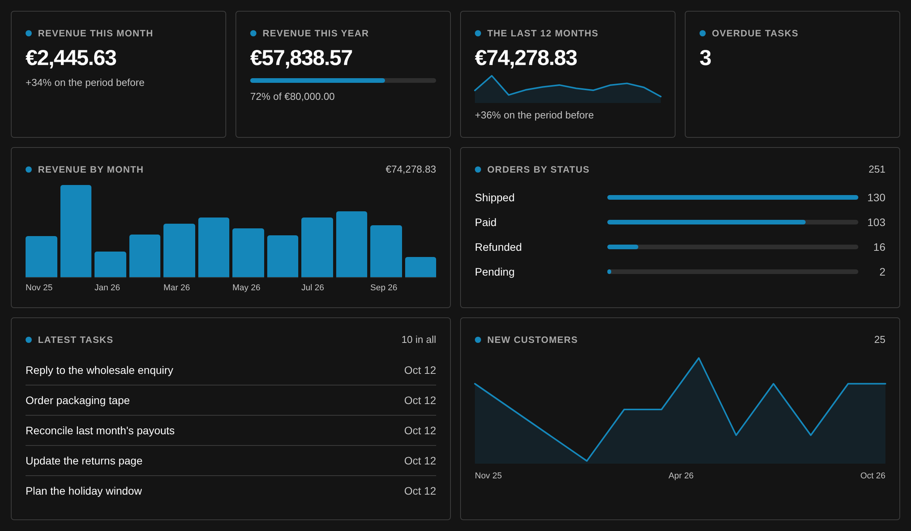

# Theming



The tiles follow the admin's theme by themselves, light and dark. Their stylesheet is in a cascade layer of its own
(`widgets`, above `payload-default`). So **anything a project writes outside a layer wins without `!important`**,
whatever its selector.

```css
/* in your admin stylesheet, e.g. src/app/(payload)/custom.scss */
:root { --widgets-accent: var(--theme-warning-500); --widgets-radius: 0; }
[data-widget='overdue'] .widgets-tile__value { color: var(--theme-error-500); }
[data-trend='down'] .widgets-tile__note { color: var(--theme-error-500); }
.widgets-tile[data-tone='bad'] { --widgets-border: var(--theme-error-500); }
```

## Variables

Each one falls back to the admin's own:

| | |
| --- | --- |
| `--widgets-accent` | the dot of a tile that is doing fine, and a chart's bars |
| `--widgets-warn`, `--widgets-bad` | the dot of one that wants attention, and of one that is late; what is late in a list |
| `--widgets-link` | the links of a tile: "+ New", and a project's own |
| `--widgets-bg`, `--widgets-bg-hover` | a tile's background, and under the pointer |
| `--widgets-border`, `--widgets-border-hover` | its border, and under the pointer |
| `--widgets-radius`, `--widgets-padding` | its corners, and the room inside it |
| `--widgets-text`, `--widgets-muted`, `--widgets-label` | what it says; what it says under that (notes, the details of a row, a bar's amount); what it is called |
| `--widgets-label-size`, `--widgets-value-size`, `--widgets-text-size`, `--widgets-note-size` | |
| `--widgets-chart-height`, `--widgets-spark-height` | how tall columns and a line are drawn, and the line under a figure |
| `--widgets-series-1` … `--widgets-series-8` | the colours of a chart's series, in this order; a ninth is drawn as the first again |

Other variables in the stylesheet are its own workings and not for a project to set: `--widgets-at`,
`--widgets-gutter`, `--widgets-zero`, `--widgets-scale-*` and `--widgets-palette-*`.

### Series colours

Left alone, the series are drawn in eight colours of the plugin's own, one set for the light theme and one for the
dark. Any two of them are told apart with the common kinds of colour blindness, at an OKLab ΔE of at least 9.7 in
light and 10 in dark, as simulated after Machado 2009. Each stands out at least 3:1 against the tile.

| | light (on #ffffff) | dark (on #141414) |
| --- | --- | --- |
| `--widgets-series-1` | `--widgets-accent`, else the admin's blue #1587ba (4.0:1) | the same (4.6:1) |
| `--widgets-series-2` | the admin's orange #b96c0d (4.0:1) | the same (4.6:1) |
| `--widgets-series-3` | violet #7a3fd0 (6.1:1) | #8b56f9 (4.2:1) |
| `--widgets-series-4` | green #52915f (3.8:1) | #71ab88 (6.9:1) |
| `--widgets-series-5` | plum #8c186a (8.6:1) | #a73c7a (3.1:1) |
| `--widgets-series-6` | olive #766200 (6.0:1) | #ba9f17 (7.1:1) |
| `--widgets-series-7` | indigo #3647a4 (8.1:1) | #5657bc (3.1:1) |
| `--widgets-series-8` | lilac #b96bf0 (3.3:1) | #d0a4fb (9.1:1) |

Red is left out: it says that something is wrong.

## Classes

Their names stay the same:

| | |
| --- | --- |
| `.widgets-tile` | with `__label`, `__value`, `__progress`, `__note`, `__trend`, `__sign`, `__head`, `__rows`, `__late`, `__action`, `__add`, and in the quick-add box `__field`, `__submit`, `__done` |
| `.widgets-chart` | bars: with `__label`, `__bar`, `__value` |
| `.widgets-columns` | with `__bar`, `__label` |
| `.widgets-line` | with `__plot`, `__stroke`, `__area`, `__zero`, `__point`, `__dot`, `__labels`; `.widgets-line--spark` under a figure |
| `.widgets-scale` | with `__tick`: what the top of columns or a line comes to, and nought |
| `.widgets-tip` | with `__label`, `__value`, `__mark`: what a column or a point comes to, on the pointer and on focus |
| `.widgets-legend` | with `__mark`, `__total`, `__note` |
| `.widgets-quick`, `.widgets-note` | |
| `.widgets-hidden` | what is there for a screen reader only, such as a chart's table of its figures |

## Attributes

Each tile says these of itself:

| | |
| --- | --- |
| `data-kind` | `figure`, `list`, `chart`, `notice`, `note` |
| `data-tone` | `calm`, `warn`, `bad` |
| `data-view` | `number`, `progress`, `sparkline`; `bars`, `columns`, `line` |
| `data-trend` | on a figure that is compared: `up`, `down`, `flat` |
| `data-notice` | on a notice: `error`, `denied`, `unset` |
| `data-widget` | the slug of a ready-made widget, or the `name` a component was given |
| `data-series` | on what is drawn of a series: `1` to `8` |
| `data-many` | on a chart of several series: `stacked` or `grouped` |
| `data-signed`, `data-below` | on a chart or a line where something goes below nought, and on that part |
| `data-align` | on a tooltip, which way it leans at the edges |
| `data-ticks`, `data-tick` | on the scale, and on each of its ticks |

```css
.widgets-tile[data-widget='unpaid-invoices'] { --widgets-value-size: 40px; }
.widgets-tile[data-tone='bad'] { --widgets-border: var(--theme-error-500); }
```

## The stylesheet by itself

The stylesheet is also there by itself, as `payload-plugin-widgets/widgets.css`, for a page that draws the classes
without the components.
