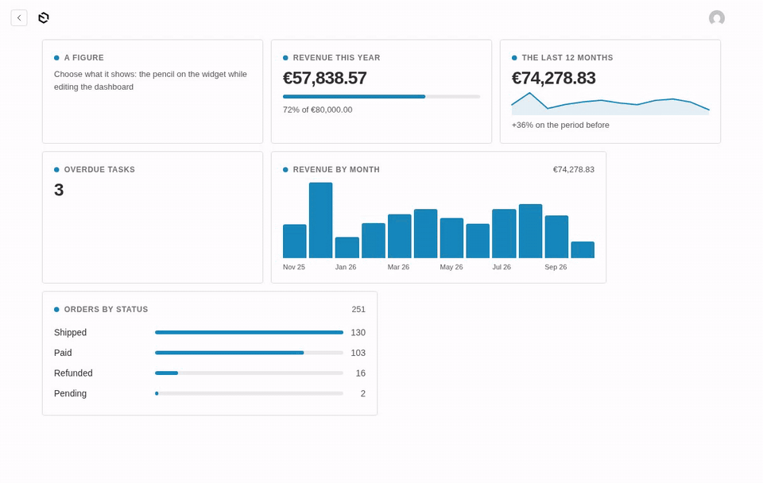
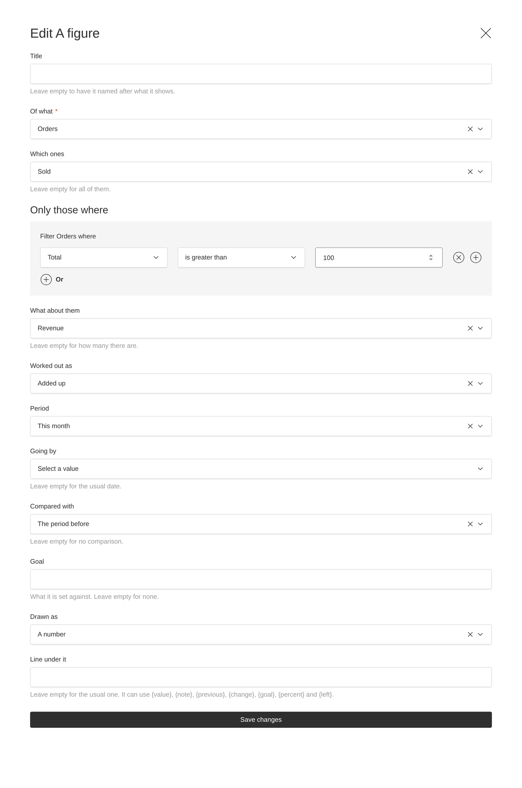

# User widgets and access

- [Setting a widget up on the dashboard](#setting-a-widget-up-on-the-dashboard)
- [Which widgets the drawer offers](#which-widgets-the-drawer-offers)
- [Who sees what](#who-sees-what)
- [A total of what somebody may not open](#a-total-of-what-somebody-may-not-open)
- [Settings of a widget read with the server's access](#settings-of-a-widget-read-with-the-servers-access)

## Setting a widget up on the dashboard



Open the dashboard and choose **Edit Dashboard** from the menu beside its name. Then add a "Figure", a "List" or a
"Chart". The pencil on a widget opens its drawer.

Anybody signed in can add these to their own dashboard and say what each shows. What they pick from is what they
may read: a source that is not for them is not offered.



The settings are under three headings. A list has no "When".

| In the drawer | For | What it says |
| --- | --- | --- |
| **What is counted** | | |
| Of what | all | The source: a collection, or one the project declared. |
| Which list | list | One of the source's lists, where it has more than one. |
| Which ones | all | One of the source's filters, where it declares any. |
| Only those where | all | Payload's own filter builder, over the collection's fields. On top of "Which ones". |
| What about them, What is drawn | figure, chart | The measure. Empty is how many there are. |
| Worked out as | figure, chart | Added up, the average, the lowest or the highest: for a measure that is a number field. |
| Split by | chart | Time, or one of the source's groups. |
| A series for each | chart | Another of the source's groups to tell every bar apart by. |
| **When** | | |
| Period | figure, chart | Any time, today, before today, from today on, this month, this year, the last 30 days, the last 12 months, or between two dates. |
| Going by | figure, chart | Which date the period goes by, where the source has more than one. |
| From, Until | figure, chart | The two dates of "Between two dates". Either may be left open. |
| Compared with | figure | The period before. Only offered for a period that has a beginning. |
| **How it looks** | | |
| Drawn as | all | A number, progress or a sparkline; bars, columns or a line; and any view the project added. |
| Goal | figure | What the figure is set against. Progress is refused without one. |
| Line under it | figure | What the note says, in place of the usual. |
| How many rows | list | |
| Title | all | What the tile is called. Empty, it is named after what it shows ("Orders · Sold · Revenue"). |

A click on a figure or on a bar leads to the collection's list view, filtered to exactly the records it counted.

Payload keeps each person's layout as their own preference. The ready-made widgets are what a dashboard starts with
and what "Reset Layout" goes back to. Somebody who has rearranged theirs keeps it after `widgets` changes, until
they reset it.

What is wrong with a widget somebody set up themselves is said on its tile, in the names the admin shows them, in
production as well. This happens, for example, after the config changed under it.

## Which widgets the drawer offers

By default everybody signed in may set up all three, of any source that is for them. `userWidgets` narrows that:

```ts
widgetsPlugin({
  userWidgets: {
    kinds: ['figure', 'chart'],                                   // no lists
    sources: ['orders', 'tasks'],                                 // by the name a source is given, or its collection
    access: ({ req }) => Boolean(req.user?.roles?.includes('admin')),
  },
})

widgetsPlugin({ userWidgets: false })                             // none; the ready-made ones stay
```

| | |
| --- | --- |
| `kinds` | Which of `'figure'`, `'list'` and `'chart'` are offered. All three where it is left out. |
| `sources` | Which sources they may be of. Any where it is left out. |
| `access` | Who may have them: `({ req }) => boolean \| Promise<boolean>`. This is not a Payload `Access`: a `Where` is not taken. One that throws is a no. |

`kinds` and `sources` narrow what the drawer offers. All three are asked again on every request, `access` once a
request. A widget set up before something was taken away says "Not available to this account", and shows nothing
of it.

## Who sees what

Every read is made as the signed-in user (`overrideAccess: false`, with their request and its locale), so
**Payload's access control always applies**: a figure counts only what that person may read.

On top of it, `access` on a source or a widget says who it is *for*: who is offered it, and who starts with it. It
is Payload's own `Access`, written and typed like the one on a collection, and handed `{ req }`:

```ts
import type { Access } from 'payload'

const admins: Access = ({ req }) => Boolean(req.user?.roles?.includes('admin'))
const theirOwn: Access = ({ req }) => ({ assignee: { equals: req.user?.id } })

source('orders', { access: admins })                                 // nobody else is offered it
figure('my-tasks', 'tasks', { label: 'My tasks', access: theirOwn })  // everybody's is their own
<Figure req={req} source="orders" measure="total" access={admins} />
await readFigure(req, 'orders', { measure: 'total', access: admins })
```

- `true` is everybody the collection lets read, `false` nobody. A `Where` in place of `true` leaves the widget only
  those records, and the list it leads to shows the same ones.
- A source without one is for whoever the collection lets read it. A widget without one is for whoever its source
  is for; one with its own is asked both.
- It only ever narrows. What the collection refuses, no `access` here brings back.
- An access that fails lets nobody in.
- A widget somebody may not see says "Not available to this account" in place of its figure, or nothing where it
  is `quiet`.
- `home` is asked the same way, for who starts with a widget: `home: admins`, or `home: false` for nobody.
- What a collection lets somebody read is asked once a request, however many widgets read it.

In the drawer a source is offered to whoever its `access` lets in. One that answers with a promise is offered to
everybody and refused when it is read, as the field that offers it cannot wait.

## A total of what somebody may not open

A figure or a chart can say more than its reader may read: revenue for a team that cannot open the orders. As in
the local API, that is `overrideAccess`, and as there, who then sees it is yours to say:

```ts
figure('revenue', 'orders', {
  label: 'Revenue this month', measure: 'total', period: 'month',
  overrideAccess: true,
  access: ({ req }) => Boolean(req.user?.roles?.some(role => role === 'admin' || role === 'sales')),
})

<Chart req={req} source="orders" measure="total" by="time" overrideAccess access={staff} />
await readFigure(req, 'orders', { measure: 'total', overrideAccess: true, access: staff })
```

- The collection's own access is not asked, and every read behind it is made with the server's access. That
  includes a custom measure's reads, which find `overrideAccess: true` in `context.as`.
- It has to come with an `access`, on the widget or on its source. A ready-made widget without one stops the
  config from being built. Somebody still has to be signed in.
- A filter returned by that `access` still narrows what is counted.
- The tile leads to the list behind it only for those the collection lets read. For everybody else it is not a
  link, and neither are the bars of a chart.
- The titles a chart's bars are named with are still read as the person looking.
- Only figures and charts take it, and only where a developer writes them. A list does not, since its rows are
  records, and nothing set up in the drawer does.

What it shows is still data. A chart by customer names the customers, and a figure filtered narrowly enough is one
record's number.

## Settings of a widget read with the server's access

A ready-made figure can have settings of its own (`fields`), with what they start as (`data`), which a measure or a
filter reads from `context.data`. Whoever has the widget on their dashboard can save any value for those
settings, not only the ones the drawer offers.

For a widget with `overrideAccess`, that value would be read with the server's access. So only the settings named
in `trusted` reach `context.data` as they were saved. Every other setting stays what `data` starts it as, and with
no `trusted`, none are taken.

```ts
figure('team-revenue', 'orders', {
  label: 'Revenue of the team', measure: 'total', overrideAccess: true, access: staff,
  fields: [{ name: 'team', type: 'select', options: ['north', 'south'] }],
  data: { team: 'north' },
  trusted: ['team'],
})
```

Only trust a setting whose every value is safe to show to everybody the widget is for. A measure that reads one
should still check the value it is given. A widget without `overrideAccess` is handed what was saved, whole: it
reads as the person, so a setting cannot show them more than they may read.
